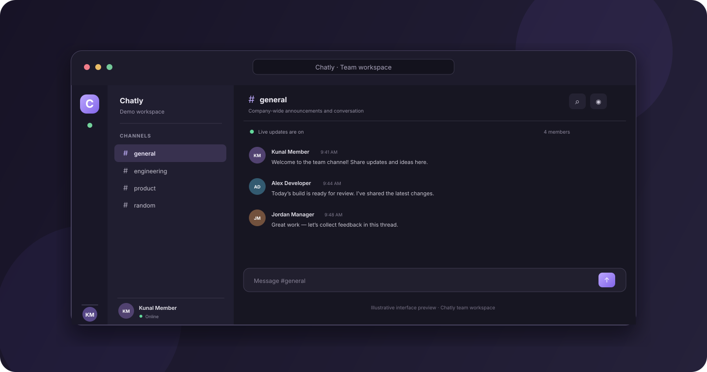
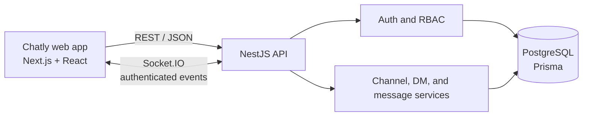

# Chatly

**A focused team chat for work that moves forward.**

Chatly is a workspace-based team messaging application. The current MVP
includes account authentication, group channels, private one-to-one
conversations, persistent messages, real-time updates, and server-side access
checks.



> The image above is an illustration of the implemented interface, not a
> production screenshot. Chatly is under active development; feature status
> and known limitations are listed below.

## At a glance

| Area | Current implementation |
| --- | --- |
| Accounts | Email/password registration and sign-in, Argon2 password hashing |
| Sessions | Short-lived JWT access tokens and rotating refresh tokens |
| Workspaces | Demo workspace membership and seeded system roles |
| Channels | Public channel listing; access checks for private channels a user is already in |
| Messages | Persistent group-channel and one-to-one DM history; latest 100 per conversation; real-time delivery |
| Discovery | Start a DM with an active workspace member; filter messages already loaded in the active conversation |
| Authorization | Server-side NestJS guards and database-backed permissions |

## What works

- Register and sign in with email and password.
- Restore the browser session, refresh expired access tokens, and sign out.
- Load workspace channels the signed-in user is allowed to access.
- Read the latest 100 messages in a group channel or one-to-one conversation and send messages.
- Start or reopen a private conversation with another active member of a shared workspace.
- Receive live channel messages and private DM updates; only conversation participants can access a DM.
- View channel members and details, filter the loaded messages, and copy a
  channel link that opens the selected channel.
- Check API availability at `/api/health` and PostgreSQL readiness at
  `/api/health/ready`.

### Current limitations

- Group messaging is provided by channels; group direct-message conversations
  are not implemented.
- Creating private channels and managing their membership are not implemented.
- Search only filters the messages currently loaded in the selected channel;
  it is not a server-side or full-history search.
- Message history is limited to the latest 100 messages; pagination is not
  implemented.
- File uploads, presence, typing indicators, read receipts, notifications,
  and the administration UI are not implemented.
- Redis and MinIO run in the optional development stack but are not yet wired
  into the MVP's messaging features.

See the [roadmap](docs/roadmap.md) for planned work.

## Architecture



## Technology

- **Web:** Next.js 14, React 18, TypeScript
- **API:** NestJS, TypeScript, REST, Socket.IO
- **Database:** PostgreSQL, Prisma
- **Workspace:** pnpm monorepo
- **Local infrastructure:** Docker Compose, PostgreSQL, Redis, MinIO

## Quick start

### Requirements

- Node.js 18 or newer
- pnpm 8 or newer
- Docker with the Docker Compose plugin, or a PostgreSQL server available on
  `localhost:5432`

### Install and configure

```bash
pnpm install
```

Create a local environment file:

```bash
cp .env.example .env
```

Set `DATABASE_URL` to credentials accepted by your local PostgreSQL server.
For Docker Compose, `CHATLY_DB_USER` and `CHATLY_DB_PASSWORD` configure the
PostgreSQL container and the API's database URL. Choose your own local
development password; do not commit `.env`.

> Compose initializes database credentials when it first creates its data
> volume. Editing `.env` later does not change a role in an existing database.
> Update the PostgreSQL role with an administrator if its credentials need to
> change. Do not remove the volume unless you intend to delete its data.

### Start the services

Start PostgreSQL, Redis, and MinIO:

```bash
docker compose up -d postgres redis minio
```

Generate the database client, create/update the local schema, and add the demo
workspace and accounts:

```bash
pnpm db:generate
pnpm db:push
pnpm db:seed
```

Start the web app and API:

```bash
pnpm dev
```

| Service | Address |
| --- | --- |
| Chatly web app | http://localhost:3000 |
| API | http://localhost:3001/api |
| API health | http://localhost:3001/api/health |
| PostgreSQL readiness | http://localhost:3001/api/health/ready |
| MinIO console | http://localhost:9001 |

Seeded demo sign-in:

```text
Email:    member@chatly.local
Password: password123
```

The demo password is for local development only. Do not reuse it in a deployed
environment.

### Run the complete Docker stack

Copy `.env.example` to `.env`, set unique JWT secrets, and then run:

```bash
docker compose up --build
```

The API container applies the Prisma schema and seed data before starting the
API. The web build uses `NEXT_PUBLIC_API_URL`; change it to the browser-visible
API address when web and API are deployed separately.

## Development commands

| Command | Purpose |
| --- | --- |
| `pnpm dev` | Start workspace development servers |
| `pnpm -r build` | Build all workspace packages |
| `pnpm -r typecheck` | Type-check all workspace packages |
| `pnpm -r lint` | Run configured linters |
| `pnpm --filter @chatly/api test` | Run API unit tests |
| `pnpm db:generate` | Generate Prisma Client |
| `pnpm db:push` | Apply the Prisma schema to the configured database |
| `pnpm db:seed` | Seed demo roles, workspace, channels, and accounts |

## Project layout

```text
apps/
  api/                 NestJS API, auth, RBAC, chat, health checks
  web/                 Next.js Chatly interface
packages/
  authorization/       Shared permission definitions
  database/            Prisma schema, client, and seed script
docs/
  api/                 API specification
  architecture/        Architecture and project structure
  schema/              Database schema notes
  roadmap.md           Implemented and planned work
```

## Security notes

- Local secrets belong in `.env`, which is ignored by Git. Commit only example
  configuration such as `.env.example`.
- Use unique JWT secrets of at least 32 characters outside local development.
- Passwords are hashed with Argon2; refresh tokens are stored as hashes and
  rotated when refreshed.
- REST routes and Socket.IO connections require authentication except for
  explicitly public auth and health routes.
- Authorization is enforced by API guards; hiding a UI control is not an
  authorization check.

## Documentation

- [API specification](docs/api/api-spec.md)
- [Architecture overview](docs/architecture/overview.md)
- [Project structure](docs/architecture/project-structure.md)
- [Database schema](docs/schema/database-schema.md)
- [Roadmap](docs/roadmap.md)
