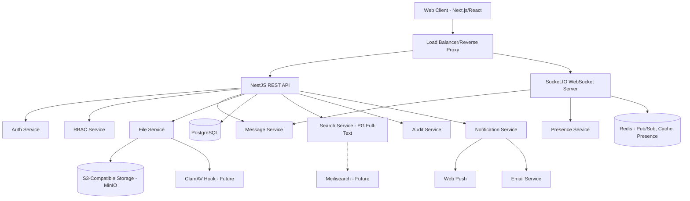
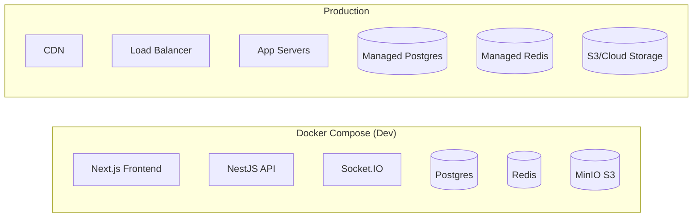

# Chatly Architecture Overview

## High-Level Architecture

Chatly is designed around the following client-server architecture. Most
messaging, presence, file, search, and notification components are planned;
the current implementation is limited to the API health and auth modules.

## Tech Stack

| Layer | Technology | Purpose |
|---|---|---|
| Frontend | React + Next.js + TypeScript + Tailwind CSS | Web client with SSR/SSG capabilities |
| Backend | Node.js + NestJS + TypeScript | REST API and WebSocket server |
| Database | PostgreSQL + Prisma/TypeORM | Primary data store with migrations |
| Cache/Pub-Sub/Presence | Redis | Real-time features, session cache, presence tracking |
| File Storage | S3-compatible (MinIO local) | Object storage for files/images |
| Search | PostgreSQL Full-Text (extensible to Meilisearch) | Message and content search |
| Auth | JWT (access + refresh) | Email/password auth, OIDC-ready design |

## System Components

### Authentication & Authorization
- **Auth Module**: Email/password registration/login, JWT token management, refresh token rotation
- **RBAC Module**: Role-based access control with permissions stored in DB (not hardcoded)
- **Guards & Decorators**: Server-side enforcement on REST and WebSocket endpoints
- **Scope System**: Permissions can be scoped to workspace, team, or channel level
- **Multi-role Support**: Users can have different roles across different scopes

### Real-time Communication
- **WebSocket Gateway**: Socket.IO for real-time messaging
- **Presence Service**: Online/offline status, last seen tracking via Redis
- **Typing Indicators**: Ephemeral events for typing status
- **Message Status**: Sent/delivered/read tracking with per-recipient status
- **Pub/Sub**: Redis pub/sub for scaling across multiple instances

### Messaging
- **Message Service**: CRUD operations for messages with threading support
- **Current MVP**: Persistent group-channel messages and participant-authorized one-to-one DMs with REST and Socket.IO delivery
- **Thread Support**: Replies create threads with parent message references
- **Message Actions**: Edit, delete (soft delete with scope), forward, pin, star, reactions
- **Mentions**: @mention parsing and notification triggering
- **Message Status Tracking**: Delivery receipts per recipient with group read receipts

### File Handling
- **Upload Service**: Direct upload to S3 with presigned URLs
- **Validation**: File type allowlist, size limits (configurable)
- **Processing**: Thumbnail generation for images
- **Security**: Signed expiring download URLs, virus scan hook
- **Drag & Drop/Paste**: Client-side handling with upload progress

### Search
- **Search Service**: PostgreSQL full-text search on messages
- **Multi-entity Search**: Messages, users, channels, files
- **Permission Filtering**: Results filtered by user's channel access
- **Extensible Design**: Abstract interface for future Meilisearch migration

### Notifications
- **Notification Service**: In-app notifications for mentions, DMs, etc.
- **Web Push**: Push notifications via service workers
- **Email Digest**: Periodic emails for missed messages
- **Mute Settings**: Per-channel mute configuration

### Admin & Audit
- **Admin Panel API**: User/role/channel management
- **Audit Logging**: All sensitive actions logged with context
- **Retention Policies**: Configurable message/file retention
- **Export**: Data export functionality

## Security Architecture

### Authentication Security
- Passwords hashed with argon2 (preferred) or bcrypt
- JWT access tokens (short-lived) + refresh tokens (long-lived, rotated)
- Rate limiting on auth endpoints
- Secure token storage recommendations

### API Security
- Input validation with class-validator on all DTOs
- XSS protection via sanitization
- CSRF protection for cookie-based flows
- SQL injection prevention via parameterized queries (Prisma/TypeORM)
- Strict CORS configuration
- Security headers (Helmet)
- TLS everywhere

### Authorization
- All permissions enforced server-side via NestJS Guards
- RBAC decorators for declarative permission checks
- Resource-level and scope-level permissions
- WebSocket event authorization
- UI permission checks are for UX only

### Data Security
- Signed, expiring URLs for file downloads
- File type validation and scanning hooks
- Audit trails for sensitive operations
- Environment-based secrets management

## Deployment Architecture

## Scalability Considerations
- Horizontal scaling via Redis pub/sub for WebSocket events
- Stateless API design for easy scaling
- Database indexing strategy for performance
- Cursor-based pagination for message history
- Efficient presence tracking in Redis
- CDN for static assets and file thumbnails
